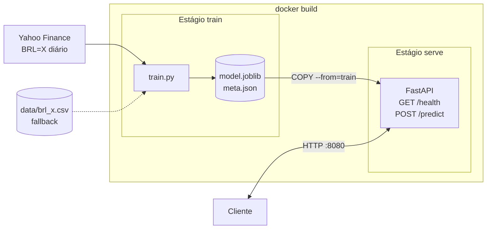

# dolar-predictor-docker

Atividade ponderada do M7 (Inteli, 2026), feita em 100 minutos: treinar um modelo que prevê o fechamento do dólar em reais (USD/BRL) no dia seguinte e servir esse modelo numa API Python dentro de um container Docker. O enunciado original está em [ENUNCIADO.md](ENUNCIADO.md).

O objetivo é demonstrar a integração entre treino, artefato do modelo, container de inferência e cliente. A previsão não é recomendação de investimento.

## Como está organizado

| Caminho | O que é |
|---|---|
| `notebooks/treino.ipynb` | Exploração: coleta do Yahoo Finance (`BRL=X`), features, treino, comparação com o naive e export |
| `models/` | Artefato gerado pelo notebook (`model.joblib` + `meta.json`) |
| `API-dolar/` | `train.py` (o notebook em script), `app.py` (FastAPI) e o `Dockerfile` multistage |
| `devlog.md` | Registro do desenvolvimento |

## Devlog

O [devlog](devlog.md) registra, na ordem em que aconteceram:

- a arquitetura inicial (notebook + bind mount) e por que ela mudou para build multistage;
- a ideia descartada de um `POST /load` para trocar o modelo em tempo de execução;
- os diagramas de sequência (Mermaid e o esboço no papel);
- a escolha de série univariada e as limitações dela;
- o bloqueio de DLLs do pandas e do scikit-learn pelo Windows e o downgrade que resolveu;
- os testes do container e os resultados do modelo.

## Arquitetura



O treino roda dentro do `docker build`. A imagem final só recebe o artefato e as dependências da API.

## Como executar

Pré-requisito: Docker. Comandos em PowerShell, de dentro de `API-dolar/`:

```powershell
docker build -t dolar-api --build-arg TRAIN_DATE=$(Get-Date -Format yyyy-MM-dd) .
docker run --rm -p 8080:8080 dolar-api
```

Mudar `TRAIN_DATE` força o retreino com os dados mais recentes. Se o Yahoo não responder durante o build, o treino usa `API-dolar/data/brl_x.csv`.

Testes (com [HTTPie](https://httpie.io/) ou pelo Swagger em http://localhost:8080/docs):

```powershell
http :8080/health
http POST :8080/predict closes:='[5.1905,5.1875,5.2229,5.2029,5.1791,5.2226]'
```

O `/predict` recebe os últimos 6 fechamentos, do mais antigo para o mais recente, e devolve a previsão do fechamento seguinte.

## Modelo e resultados

Ridge sobre os log-retornos dos últimos 5 dias, prevendo o log-retorno do dia seguinte. O preço sai de `último fechamento × exp(retorno previsto)`. O baseline é o naive (amanhã = hoje).

Teste cronológico de 24/05/2024 a 01/10/2026 (610 dias, últimos 20% da série):

| | MAE (R$) | RMSE (R$) | Acerto de direção |
|---|---|---|---|
| Naive | 0,0329 | 0,0448 | não se aplica |
| Ridge | 0,0326 | 0,0443 | 55,9% |


A Ridge fica menos de 1% melhor que o naive em MAE: na prática, os dois modelos são quase iguais. É o esperado para câmbio diário usando só o histórico da própria série.

## Limitações

- **Modelo univariado.** Juros, política fiscal e eleições não entram no modelo. Em 05/10/2026, dia seguinte ao primeiro turno, o modelo previu 5,22 e o dólar foi para perto de 4,99.
- **Modelo atualizado só no build.** O modelo fica tão atual quanto o último `docker build` com um `TRAIN_DATE` novo.
- **Build não reproduzível.** Builds em dias diferentes geram modelos diferentes. A data dos dados e as métricas de cada build ficam no `meta.json`, exposto em `/health`.
