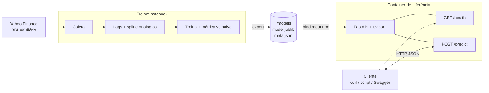
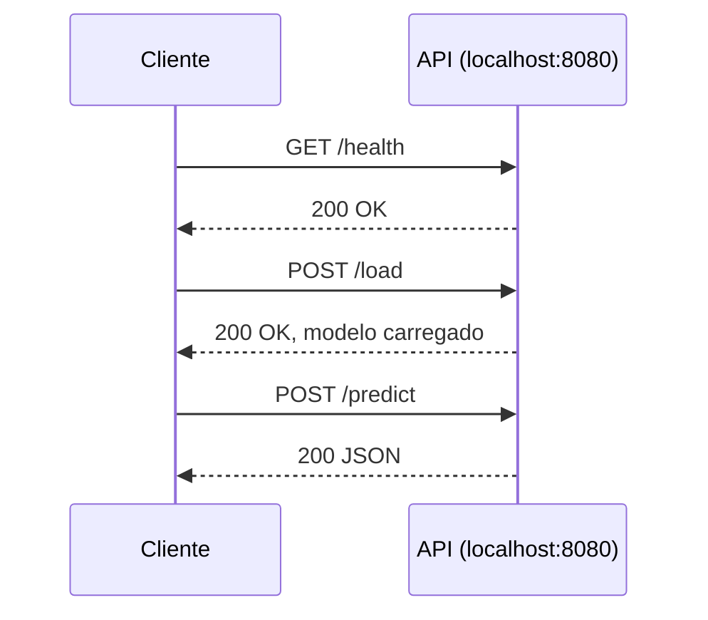
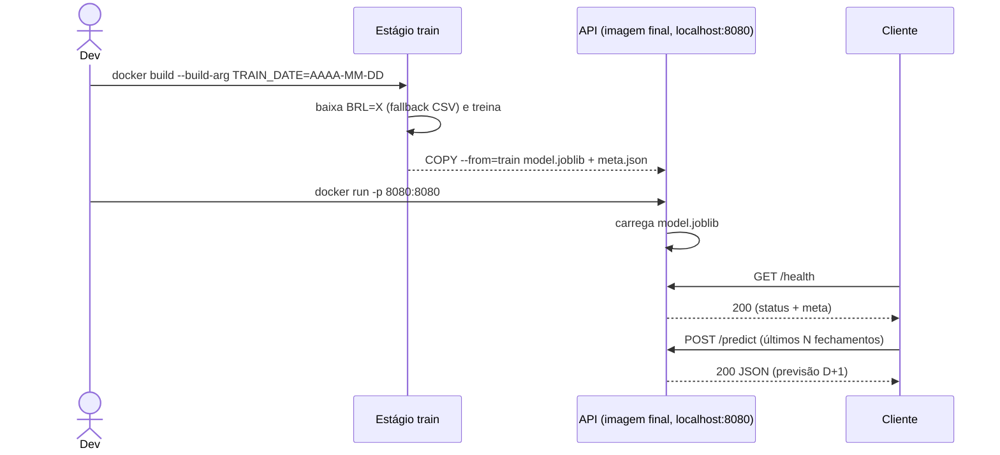
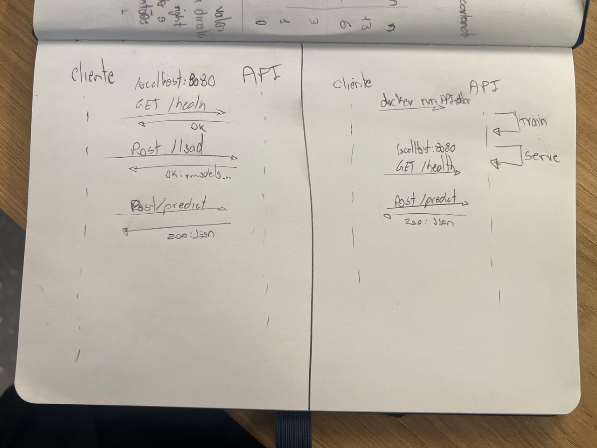
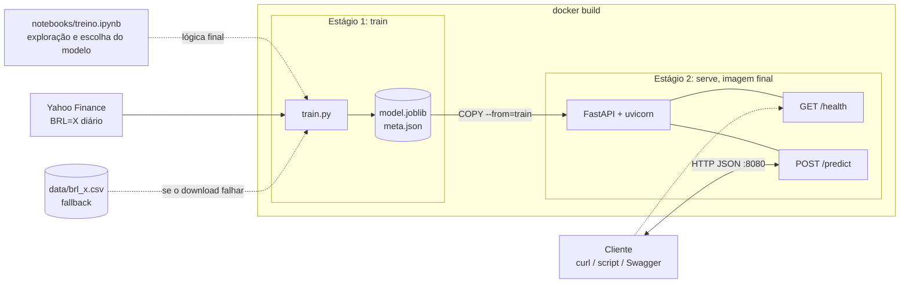
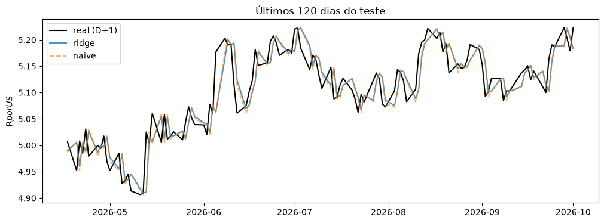
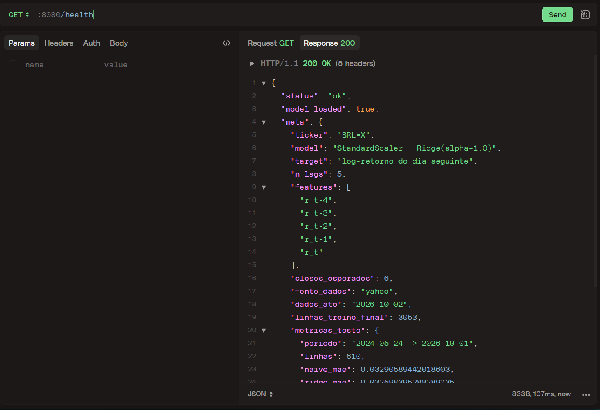
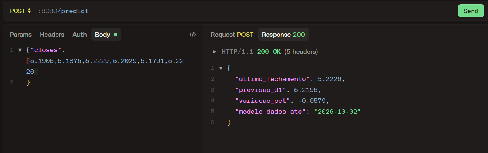

comecei lendo o readme e organizando as coisas na minha cabeca

como todo com sistema quero comecar com a arquitetura muito bem estabelecida. antes de desenhar pensei em algo grosseiro:

"primeiro precisamos pensar em uma arquitetura do sistema. o q eu imagino que faca sentido eh simplesmente primeiro fazer um notebook pra treinar o modelo, dai depois, se der certo passamos tudo para um docker. exportamos os pesos e passamos para um outro docker pra buildar a API. mas primeiro vamos pensar na arquitetura e tudo que poderia existir nela."
 
conversando com o claude sobre arquitetura e sobre treinamento. 

ponto de agora eh quais metricas usar para treinar um preditor de dolar. uso outra currency?

vamos de serie temporal normal. sem modelo com features. tudo univariado mesmo. isso nao mudava a arquitetura, mas queria tirar da minha cabeca essa decisao logo. 

o fato de estar fazendo uma serie temporal normal faz o negocio ser um pouco complicado. prever currency com base soh em historico me parece meio burro. pq no final das constas as mudancas economicas que mais importam, selic, juros amerinos, nasdaq... nao entram na conta e no final o modelo provavelmente vai ficar mais proximo do naive do que gostariamos. mas vamos ver. esse eh o exercicio mesmo. vamos prever USD em relacao ao BRL, entao as duas economias impactam na previsao. 

## Arquitetura

depois de fazer essa arquitetura e quando estava fazendo o UML vi que precisava de alguma forma mais dinamica da API receber os pesos. nao queria deixar uma API com pesos hardcoded. entao pensei em um POST /load  que enviaria os pesos. mas depois pensei que isso complicaria muito a inferencia, pq eu necessariamente precisaria jogar no /load modelos compativeis... varias outras coias. o que pensei para ser o meio termo eh fazer um build multi-stage. primeiro estagio eh treinamento do modelo e segundo estagio soh serve o modelo pronto na API. dai sempre que der um build vai puxar os dados mais atualizados o yfinance pra treinar e ja suprir o modelo. o downside eh o tempo pra treinar o modelo e que queria que fazer isso sempre, mas acho que compensa pra ter um modelo sempre atualizado em uma imagem.

conversando com o claude to vendo que nao necessariamente o modelo vai estar sempre atualizado por causa do cache de build do docker, e tmb, um modelo treinado um mes atras e outro treinado hoje provavelmente vao prever valores muito parecidos para amanha, entao nao faria tanta diferenca. o bom do multistage eh o treinamento estar acoplado neh, entao tem mais reprodutibilidade. 

continuando o UML:

## Diagramas de sequência

### Versão 1 (descartada): API com POST /load

### Versão 2: build multistage (treino no build, inferência no run)

### Esboço original no papel

quando fiz no papel tinha deixado a segunda versao (a que vou seguir) com o treinamento no run, troquei isso no mermaid pra ficar treinamento no build mesmo. faz mais sentido pra esse caso.

## Arquitetura versão 2: build multistage

considerando o UML e tmb as decisoes de projeto, a nova arquiteura contempla o build multi-stage e o diagrama

seguir para o notebook:

ta tive dificuldade com a versao mais atual do pandas. a 3.0.6 deu erro no meu windows. deu um erro de DDL, windows nao confiou. o sktlearn tmb deu o mesmo. tive que dar um downgrade nas duas biblios. me custou uns bons 10 min. claude tinha proposto rodar um servidor de jupiter dentro de um docker mas eu insisti e deu boa aqui mesmo (o bicho tava ansioso pra jogar no docker ja)

testandoo modelo...

entrada: [5.1905, 5.1875, 5.2229, 5.2029, 5.1791, 5.2226]
último fechamento: 5.2226 em 2026-10-02
previsão D+1: 5.2196

hoje o mercado ta fechando (ainda nao fechou neh, sao 15h44) mais proximo de 4.9. hoje eh um dos piores dias pra prever neh, as eleicoes de ontem jogaram o dolar pra baixo e o model tava indo no caminho de antes. e justamente por estarmos fazendo um modelo de serie temporal univariada o modelo nao consegue prever bem esse tipo de flutuacao pq soh tem a propria variavel pra trabalhar e nao tem as variaveis que causam essas flutuacoes. mas isso foi escolha la no comeco. eu queria fazer algo multivariado mas dai demora mais pra treinar e eh mais complexo no geral, entao nao queria princar com isso. 

resultado de comparacao com naive. modelo nao ta mt legal, mas vamos seguir para o multi-stage:

testando o docker agora. decidi testar direto dentro do docker pq no final das constas nao tem mt misterio no docker. entao se for pra testar o codigo dentro ou fora, ja testo dentro do docker.

docker build -t dolar-api --build-arg TRAIN_DATE=$(Get-Date -Format yyyy-MM-dd) .
docker run --rm -p 8080:8080 dolar-api

show, /health ta funcionando.

/predict tambem. dei os ultimos 6 valores até sexta, dai ele ta prevendo o valor que seria para o fechamento de hoje. ta errando totalmente neh. mas vamos ver. quando hoje fechar vai ser interessante ver o qq ele vai prever para amanha. vai ficar numa media. uns 5.1 eu imagino

sobre os resultados do modelo:

  "metricas_teste": {
    "periodo": "2024-05-24 -> 2026-10-01",
    "naive_mae": 0.03290589442018603,
    "ridge_mae": 0.032598395288289735,
    "naive_rmse": 0.04481985388857022,
    "ridge_rmse": 0.044343419328892686,
    "ridge_acerto_direcao": 0.559016393442623
  },

  temos resultados levemente melhores que o naive, tanto no MAE quanto no RMSE, mas muuuito levemente melhores. quase nao da pra considrar que sao modelos diferentes. o interessante mesmo vai ser ver o fechamento de hoje. 

  